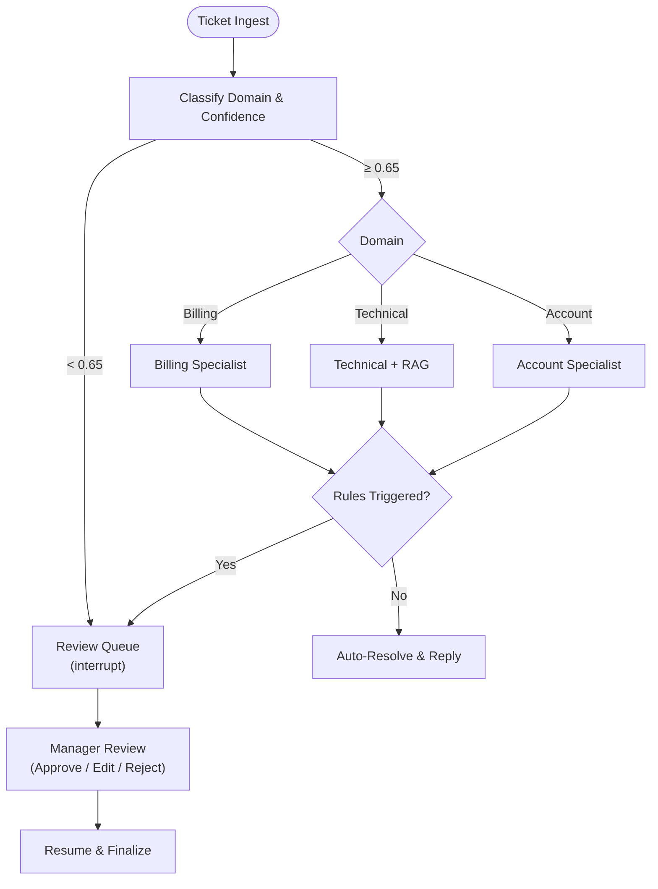

# CloudDesk - Smart Customer Support Agent

CloudDesk is a customer support system that resolves routine inquiries automatically while keeping humans in control of sensitive cases.

AI support tools can give inaccurate answers or mishandle billing and account requests. CloudDesk reduces this risk with domain-based ticket routing, knowledge-base retrieval, and **deterministic, code-enforced escalation rules**.

- **Auto-resolve** straightforward inquiries using internal knowledge articles and known-issue data.
- **Escalate** high-risk cases to a human review queue: billing disputes, transactions over ₹5,000, account deletions, data loss, security concerns, and low-confidence classifications.
- **Pause and resume** workflows, continuing after a reviewer approves, edits, or rejects the proposed resolution.


## Table of Contents

- [The Problem & Motivation](#the-problem--motivation)
- [Architecture & Workflow](#architecture--workflow)
- [Design Decisions & Tech Stack Justifications](#design-decisions--tech-stack-justifications)
- [Quick Start](#quick-start)
  - [Option 1: Docker Compose (Recommended)](#option-1-docker-compose-recommended)
  - [Option 2: Local Development](#option-2-local-development)
- [API Reference](#api-reference)
- [How I Used AI](#how-i-used-ai)
- [Assumptions, Blockers & Roadmap](#assumptions-blockers--roadmap)

---


## Architecture & Workflow



---

## Design Decisions & Tech Stack Justifications

### 1. Why PostgreSQL + pgvector

Instead of splitting relational data and vector embeddings across separate platforms (e.g. Postgres + Pinecone/Qdrant), CloudDesk runs entirely on **PostgreSQL 16 with the `pgvector` extension**:

- **ACID integrity**: Customers, transactions, reviews, and tickets share one transactional boundary, so constraints (e.g., no duplicate reviews) apply atomically with vector updates.
- **Hybrid filtering in one query**: Metadata filters and semantic similarity search run in a single SQL plan, with no extra network hops.
- **Less infrastructure**: No third-party vector service, API quotas, or added failure modes.

### Why Pytest
- **Deterministic safety checks**: All 13 escalation rules (transactions > ₹5,000, account deletion, data loss, security keywords, confidence < 0.65) are verified across edge cases in milliseconds.
- **Isolated async tests**: `pytest-asyncio` with a `NullPool` engine rolls back each test's DB transaction, preventing connection leaks and cross-test contamination.
- **Fast feedback**: The full 61-test suite runs in under 2 seconds, covering API contracts, LangGraph transitions, mock LLM fallbacks, and review cycles.

### Why Next.js
Next.js 16 powers the agent and manager dashboard:

- **Suspense boundaries** for fast initial render and live ticket inspection.
- **Status polling** every 2.5s while background LangGraph tasks triage tickets.
- **Typed API layer** with shared TypeScript interfaces matching FastAPI Pydantic schemas.

---

## Quick Start

### Option 1: Docker Compose (Recommended)

```bash
git clone https://github.com/exorcist09/clouddesk.git 
cd clouddesk
cp .env.example .env
docker compose up --build
```

- Frontend: http://localhost:3000
- Manager Review Queue: http://localhost:3000/review
- API Docs: http://localhost:8000/docs
- Health Check: http://localhost:8000/health

Stop with `docker compose down` (add `-v` to reset the database volume).

### Option 2: Local Development

**1. Database**
```bash
docker run -d --name clouddesk-db \
  -e POSTGRES_USER=clouddesk -e POSTGRES_PASSWORD=clouddesk -e POSTGRES_DB=clouddesk \
  -p 5432:5432 pgvector/pgvector:pg16
```

**2. Backend**
```bash
cd backend
python3 -m venv .venv && source .venv/bin/activate
pip install -r requirements.txt
alembic upgrade head && python -m app.seed
pytest -v   # 61 tests
uvicorn app.main:app --host 0.0.0.0 --port 8000 --reload
```

**3. Frontend**
```bash
cd frontend
bun install #or npm install
bun run dev #or npm run dev
```


---
## API Reference

| Method | Endpoint | Description |
|---|---|---|
| `POST` | `/api/tickets` | Submit a ticket and start background LangGraph triage |
| `GET` | `/api/tickets` | List tickets (filter by `status`, `domain`; paginated) |
| `GET` | `/api/tickets/{id}` | Full ticket details (specialist logs, draft, state) |
| `GET` | `/api/tickets/{id}/status` | Lightweight status polling |
| `GET` | `/api/tickets/{id}/reply` | Final delivered resolution |
| `GET` | `/api/reviews/pending` | Tickets awaiting manager review |
| `POST` | `/api/tickets/{id}/review` | Submit decision (`APPROVE`, `EDIT`, `REJECT`) |
| `GET` | `/health` | Service health check |

---


## How I Used AI

I treated AI as a pair-programmer: good at boilerplate and exploring options, but not trusted with architecture, safety-critical logic, or anything I couldn't verify. The rule: **AI proposes, tests and I decide.**

| Delegated to AI | Owned by me |
|---|---|
| Pydantic schema scaffolding | Escalation rules: deterministic Python, never LLM prompts |
| Regex variants for escalation triggers | LangGraph interrupt/resume design (`interrupt()`, `Command(resume=...)`) |
| ORM relation boilerplate | Embedding strategy: remote OpenRouter over local PyTorch |
| Next.js frontend | Test strategy covering every escalation rule and edge case |

**Why this split:** Refund thresholds, account deletions, and security flags are high-risk decisions that must be auditable and reproducible, which an LLM can't guarantee. AI helped write the rules, but never decides them at runtime.

### What Was Changed from AI Proposals
- **Vector dimensions**: AI hardcoded `Vector(1536)` in migrations, which broke 384-dim models. Changed to an unconstrained `Vector()`.
- **Test isolation**: AI generated singleton engines in pytest fixtures that leaked connections across closed event loops. Replaced with `NullPool` and per-test rollback in `conftest.py`.
- **Next.js 16 params**: AI read dynamic route params synchronously. Refactored to load them asynchronously inside a `<Suspense>` boundary.
- **Embedding approach**: AI installed `sentence-transformers` and `torch` (>1.2 GB), exhausting the disk quota. Switched to OpenRouter embeddings with lightweight fallback vectors for offline tests.

### Where AI Got Things Wrong
1. **Dependency Bloat & Disk Quota**: The AI initially tried installing `sentence-transformers` and `torch` (>1.2 GB), exhausting environment disk quotas. We corrected this by routing embeddings through OpenRouter's API with lightweight fallback vectors for offline test isolation.
2. **Missing Alembic Import**: Autogenerated Alembic migration missed `import pgvector.sqlalchemy`, leading to a `NameError: name 'pgvector' is not defined` during upgrade.
3. **Database Column Mismatch**: AI referenced `Payment.timestamp` in billing tools, whereas the model defined `Payment.created_at`. Fixed and validated with pytest.

---

## Assumptions, Blockers & Roadmap

### Assumptions
- **OpenRouter Free Tier Availability**: Default LLM routes use `meta-llama/llama-3.3-70b-instruct:free` and `nvidia/nemotron-3-embed-1b:free`. 
- **Single Manager Review**: A ticket in `PENDING_REVIEW` is resolved by the first manager decision submitted. Duplicate reviews return `409 Conflict`.
- **Idempotent Data Seeding**: Seed script uses deterministic IDs and `ON CONFLICT` checks, allowing safe repeated runs.

### Blockers Encountered & Resolved
- **PyTorch Disk Quota**: Resolved by eliminating local model weights and using OpenRouter's remote embedding API.
- **Pytest-Asyncio Event Loop Conflict with Asyncpg**: Resolved by configuring `NullPool` in database engine factory and standardizing function-scoped event loops in `pytest.ini`.
- **Next.js 16 App Router Suspense Boundaries**: Resolved by isolating `useParams()` in a client component wrapped by a server component Suspense fallback.

### What Comes Next
- WebSockets/SSE to replace polling
- Slack and email alerts for high-severity escalations
- Collision locking when multiple managers review
- CSAT ratings on resolved tickets

---

### Time Spent
- **Total Time**: ~4.5 hours of active development and testing and major chunk was thinking and writing a technical documentation.
- **Video Creation and Editing Time**: ~1 hour
